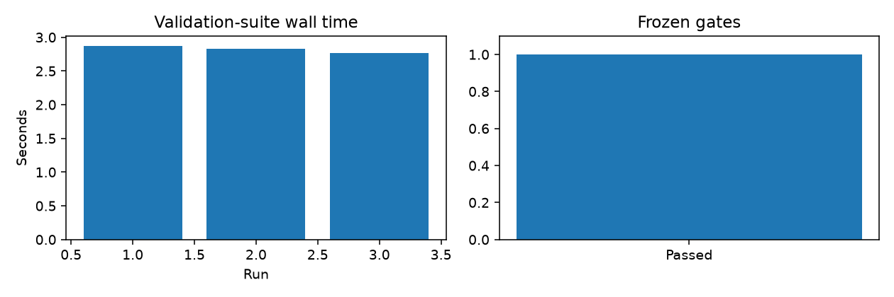

# Reconstruction report: py-muscat

Date: 2026-11-11. Upstream commit: `861683175a1804430ced420397e72fff16fe92ed`. Review-stage algorithm subset, not a full release.

## Coverage
Sum pseudobulks and explicit-design/contrast pbDS with edgeR or limma-voom. No mixed models, limma-trend, treat, DESeq2, simulation framework or automatic design inference.
See AUDIT.md and port.yaml for exported-function coverage, including skipped entries. No unimplemented export is marked complete.

## Evidence
Frozen gates: manifest.yaml (committed before code). R oracle: tests/reference.R. Offline reference fixtures: data/. Focused tests: 6 passed, no skips. All four notebooks have executed outputs. Windows wheel builds succeeded. Installed-wheel tests in a fresh Python 3.12 environment passed with no skips; see fresh-validation.log.

## Iterations
Baseline: pinned source and predetermined comparison class. Follow-up: Python candidate and invalid-input tests. SPARK-X's initial analytical-CDF shortcut failed the default R numerical gate and was replaced by Davies. muscat's initial default backend call differed in dispersion selection and was corrected from the R namespace evidence. No tolerance was relaxed. No acceleration or biological-accuracy claim is made.

## Limitations and release status
This covers the listed paths only. RUVSeq objects, SPARK GLMMs, MuSiC2 and muscat mixed models remain excluded. Synthetic fixtures are identified as such; muscat additionally runs the public Kang subset distributed by its pinned source. PyPI publication and a full rebuildr release are not claimed. The notebook parameter dictionary and coverage audit support review; installed-R full-package testing is distinct from executing selected upstream R functions.
